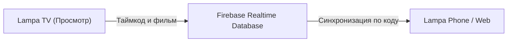

# Плагин «Синхронизация» для Lampa (sync)

Технический паспорт и документация плагина синхронизации прогресса просмотра между устройствами (ТВ, телефон, ПК) для медиаплеера Lampa.

Репозиторий GitHub: [https://github.com/manka81/sync](https://github.com/manka81/sync)  
Автор: **manka81**  
Лицензия: **MIT**

---

## 1. Стек технологий

- **Язык**: JavaScript (ES5/ES6 compatibility for Smart TV WebViews).
- **Среда выполнения**: Lampa (LG webOS, Samsung Tizen, Android TV, Web).
- **База данных реального времени**: Firebase Realtime Database (`https://synx-332c2-default-rtdb.europe-west1.firebasedatabase.app`).
- **Среда разработки**: Node.js (валидация синтаксиса `vm.Script`).
- **Скрипты сборки**: `build.bat` (чистый ASCII без BOM), PowerShell.

---

## 2. Структура файлов проекта

```text
C:\Users\manka\.gemini\antigravity\scratch\Синхронизация\
│
├── sync.js                  # Главный скрипт плагина синхронизации
├── build.js                 # Валидатор синтаксиса JavaScript
├── build.bat                # Скрипт сборки для Windows CMD
└── README.md                # Главный технический паспорт проекта (данный файл)
```

---

## 3. Назначение модулей и компонентов

| Компонент | Назначение |
| :--- | :--- |
| `sync.js` | Главный исполняемый модуль. Отслеживает события плеера, отправляет таймкоды в Firebase и синхронизирует позицию просмотра между устройствами по общему коду синхронизации. |
| `registerPluginMetadata()` | Автоматически регистрирует название плагина «Синхронизация» и автора `@manka81` в хранилище `Lampa.Storage` и обновляет карточку в интерфейсе расширений. |
| `build.js` | Проверяет валидность синтаксиса скрипта перед публикацией. |

---

## 4. Архитектура данных



---

## 5. Способы подключения в Lampa

В меню **Настройки** $\rightarrow$ **Расширения** $\rightarrow$ **Добавить плагин**:
* **CDN jsDelivr**:
  ```text
  https://cdn.jsdelivr.net/gh/manka81/sync@main/sync.js
  ```
* **Прямой GitHub Raw**:
  ```text
  https://raw.githubusercontent.com/manka81/sync/main/sync.js
  ```

---

## 6. Журнал изменений (Changelog)

### Версия 1.0.5 (17.11.2026)
- Добавлена функция `registerPluginMetadata()`: автоматическая регистрация названия («Синхронизация») и автора (`@manka81`) в меню расширений Lampa вместо «Без названия» и «@lampa».
- Обновлен динамический рендеринг карточек в интерфейсе.
- Добавлен технический паспорт проекта `README.md`.
